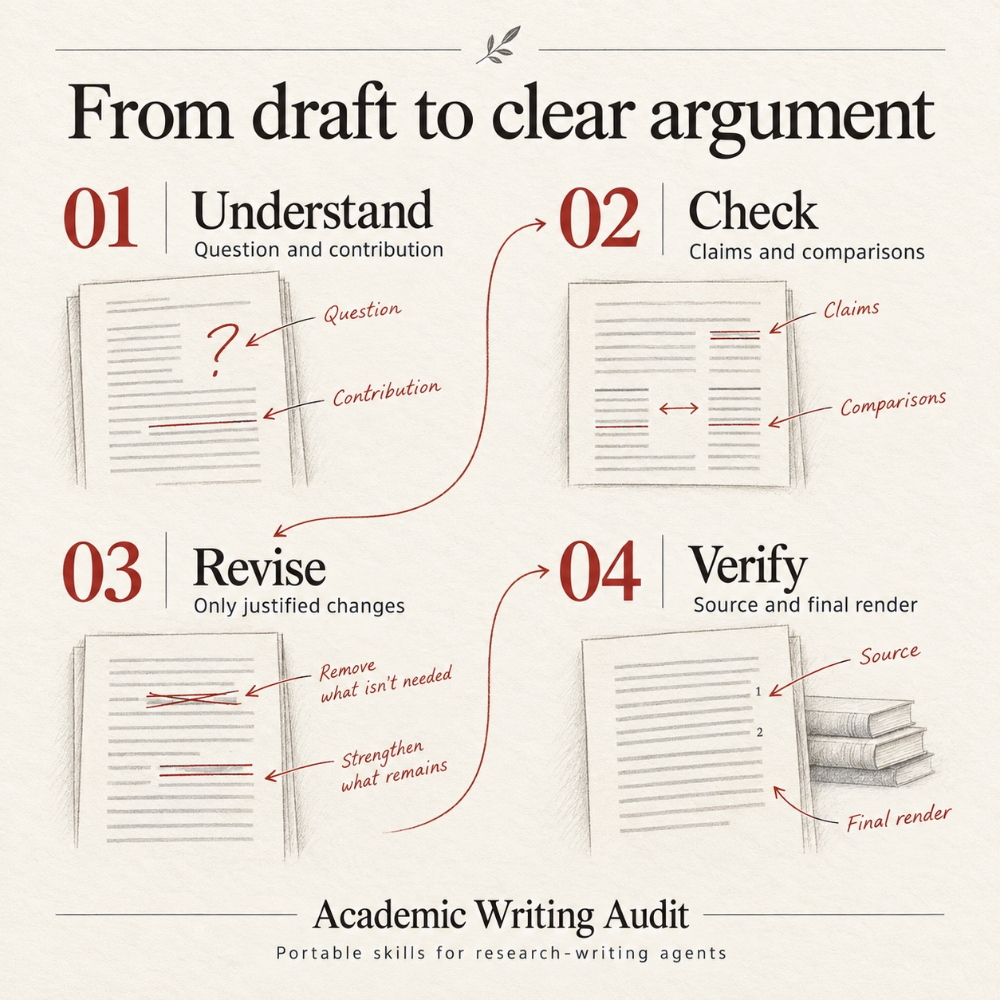

<p align="center">
  
</p>

<h1 align="center">Academic Writing Audit</h1>

<p align="center"><strong>13 portable agent skills for scientific manuscripts and reviewer responses.</strong><br>
Reconstruct the argument, check the evidence, and change only what needs changing.</p>

**中文简介｜学术论文写作与审稿回复 Skills**

把科研写作中反复遇到的问题整理成 **13 个可独立使用的 AI agent skills**，涵盖学术逻辑检查、论证与证据核查、去防御性写作、实验比较、结果解释、图表审查，以及 **审稿意见回复、response letter 和 rebuttal 写作**。新增 **去 AI 味、句式简化与冗余重复检查**，用具体的语义审查改善表达，保留科学含义和作者声音。生成的学术段落默认不用解释性冒号或句中破折号，保留术语连字符及技术符号。回复信逐点回应审稿人，论文正文直接解释研究。通用 Markdown 指令可供支持 skills 的客户端及其他能阅读 Markdown 的 agent 使用。

[中文使用说明](README.zh-CN.md) · [自然表达与逻辑审查](docs/prose-guide.md) · [审稿回复与正文写作指南](docs/rebuttal-guide.md) · [安装方法](#install)

<p align="center">
  <a href="LICENSE"></a>
  <a href="https://agentskills.io/specification"></a>
  <a href="README.zh-CN.md"></a>
</p>

<p align="center">
  <a href="#choose-a-skill">Choose a skill</a> ·
  <a href="#install">Install</a> ·
  <a href="docs/field-guide.md">Problem → repair</a> ·
  <a href="evals/library/README.md">Trial records</a> ·
  <a href="assets/README.md">Media kit</a>
</p>

---

A manuscript can become shorter and still lose its argument. A cautious sentence can be essential. A convincing result can support the full system without identifying which component caused the gain.

This library turns those recurring editorial decisions into small, reusable workflows. Use the full audit for an unfamiliar manuscript, or load one focused skill when the problem is already clear. Every skill accepts **keep as written** as a useful outcome.

## Start here

| Your task | Start with | Ask for |
| --- | --- | --- |
| Understand what needs attention in a whole paper | [Academic writing audit](skills/academic-writing-audit/SKILL.md) | Prioritized findings, evidence, and passages to preserve. |
| Repair a specific writing problem | [Choose a focused skill below](#choose-a-skill) | A bounded replacement or patch with a reason for each change. |
| Write a rebuttal or revision response letter | [Reviewer response writing](skills/reviewer-response-writing/SKILL.md) | Evidence-grounded replies, accurate change status, and separately written manuscript edits. |
| Check the final manuscript and handoff | [Manuscript release check](skills/manuscript-release-check/SKILL.md) | The verified source, build, render, and publication state. |

```text
Use $academic-writing-audit to review this manuscript.
First audit its argument, evidence boundaries, comparisons, and definitions.
Do not rewrite the file. Identify sound passages that should stay unchanged.
```

## Choose a skill

Each folder is independently installable. You do not need to load the whole collection.

| When you encounter… | Skill | What it helps you produce |
| --- | --- | --- |
| A paper needing a complete editorial diagnosis | [academic-writing-audit](skills/academic-writing-audit/SKILL.md) | A structured scientific and editorial audit. |
| Formulaic wording, tangled sentences, or repeated explanations | [academic-prose-editing](skills/academic-prose-editing/SKILL.md) | Natural paragraphs with clear reasoning and preserved scientific meaning. |
| A missing bridge between problem, contribution, and evidence | [scientific-story-audit](skills/scientific-story-audit/SKILL.md) | A connected argument that preserves the contribution's scope. |
| Rebuttal-like prose, repeated assurances, or piles of caveats | [nondefensive-writing](skills/nondefensive-writing/SKILL.md) | Direct explanations with necessary boundaries intact. |
| A paper list, false categories, or an unsupported “first” | [related-work-synthesis](skills/related-work-synthesis/SKILL.md) | Source-supported comparison axes and bounded novelty claims. |
| A conclusion stronger than its supporting observation | [claim-evidence-audit](skills/claim-evidence-audit/SKILL.md) | Claims matched to the study and inference that support them. |
| Ambiguous baselines, ablations, budgets, or data eligibility | [experiment-comparison-audit](skills/experiment-comparison-audit/SKILL.md) | Operational definitions of what was actually compared. |
| Results that merely repeat numbers or over-explain mechanisms | [results-interpretation](skills/results-interpretation/SKILL.md) | Useful interpretation with attribution and uncertainty in scope. |
| A formula or appendix pointer that never explains the operation | [method-definition-audit](skills/method-definition-audit/SKILL.md) | Plain definitions consistent with the formal procedure. |
| Arrows, captions, and endpoints that imply different things | [figure-caption-audit](skills/figure-caption-audit/SKILL.md) | Aligned visual semantics, labels, and captions. |
| Reviewer comments becoming scattered or repetitive edits | [reviewer-comment-triage](skills/reviewer-comment-triage/SKILL.md) | Current-text diagnosis and a focused reader-facing repair. |
| A rebuttal or response letter needing direct, supported answers | [reviewer-response-writing](skills/reviewer-response-writing/SKILL.md) | Concise or point-by-point replies, with evidence and verified revision locations. |
| An old PDF, uncertain compilation, or unclear submission state | [manuscript-release-check](skills/manuscript-release-check/SKILL.md) | A precise verification record and usable handoff. |

For concrete failure patterns and sample requests, see the [field guide](docs/field-guide.md).

## What a careful edit looks like

**Draft**

> We emphasize that incomplete measurements were not quietly discarded. No one should infer that our system guarantees reliable field operation.

**Supplied evidence** — Incomplete measurements receive an abstention, remain in the denominator, and have no concentration estimate. Field operation was not evaluated.

**Revision**

> Incomplete measurements received an abstention rather than a concentration estimate and remained in the evaluation denominator. The study did not evaluate field operation.

The accusation and reassurance disappear. The operative rule, denominator, and study boundary remain. A clear preceding motivation paragraph stays as written.

## Natural prose and clear reasoning

Use [academic-prose-editing](skills/academic-prose-editing/SKILL.md) to check formulaic phrasing, sentence complexity, local inference, and repeated meaning. Preserve stable terminology, necessary conditions, and useful motivation. Shorter sentences are helpful when they reduce the reader's burden, not when they erase the argument.

Generated prose defaults to connected paragraphs without explanatory colons or sentence-interrupting dashes. Compound-word hyphens, scientific notation, ratios, ranges, URLs, exact quotations, and required templates remain intact. This is a configurable editorial preference. It is not an authorship test, and author or venue instructions take precedence. Each focused skill carries the core convention so it can work independently.

```text
Use $academic-prose-editing on this passage.
Check logic, clause complexity, formulaic phrasing, and repeated propositions.
Use connected paragraphs without explanatory colons or sentence-interrupting dashes.
Keep compound hyphens, notation, exact quotations, and scientific conditions.
Preserve sound passages and explain material changes briefly.
```

See the [Chinese prose guide](docs/prose-guide.md) for examples and the distinction between redundant repetition and useful restatement.

## Reviewer responses and manuscript prose

Use the same evidence for two different purposes:

| Deliverable | Its job | Fictional example, after the edit has been checked |
| --- | --- | --- |
| Rebuttal / response letter | Answer the concern and identify the action or remaining gap. | “We have added the comparator's operational definition to Methods, under ‘Comparators.’” |
| Manuscript | Explain the research to a reader who has never seen the review. | “The comparator uses a predetermined linear score with fixed group multipliers and fits one model.” |

The new skill draws on practical author-response work and subsequent manuscript audits: group shared questions without losing individual requests, define the actual comparison, separate studies, bound attribution, and verify promised revisions. Public examples are fictional. A clear reply does not substitute for a clear revised paper.

```text
Use $reviewer-response-writing to draft this rebuttal within the supplied
venue rules. Map every comment to an answer and supporting evidence.
Distinguish completed changes from proposals. Put any proposed manuscript
text in a separate block, written for readers without reviewer references.
```

See the [中文回复写作指南](docs/rebuttal-guide.md) and [paired examples](skills/reviewer-response-writing/references/manuscript-boundary.md).

## Install

[Download a portable release bundle](https://github.com/ChangChrisLiu/academic-writing-audit/releases/latest), or install selected skills below.

The library uses the [Agent Skills format](https://agentskills.io/specification): a Markdown entrypoint, optional local references, and a license in each skill folder. Core instructions require no specific model, API, tool, or delegation workflow. Client discovery and model behavior can differ.

### With the Skills CLI

The optional [Skills CLI](https://github.com/vercel-labs/skills) supports installation into multiple agent clients. From your project directory:

```sh
# Browse the available skills without installing.
npx skills add ChangChrisLiu/academic-writing-audit --list

# Install one focused skill; choose the target agent when prompted.
npx skills add ChangChrisLiu/academic-writing-audit --skill nondefensive-writing

# Install the collection for Codex in this project.
npx skills add ChangChrisLiu/academic-writing-audit --skill '*' -a codex
```

Add `-g` for a user-wide installation. Review the selected destination before replacing an existing skill.

### Manual installation

Copy the desired folder from `skills/` into your client's configured skills directory. Keep its references and `LICENSE` together. `agents/openai.yaml` is optional Codex display metadata.

For user-wide Codex installation, run from a local clone:

```sh
skill_root="${CODEX_HOME:-$HOME/.codex}/skills"
mkdir -p "$skill_root"
test ! -e "$skill_root/academic-writing-audit" && \
  cp -R skills/academic-writing-audit "$skill_root/academic-writing-audit"
```

This copy preserves any existing installation. Substitute another folder name to install a focused skill. Open a new agent session if the installation is not discovered in the current one.

### Any agent that can read Markdown

Supply the skill's `SKILL.md` and any referenced files, then ask:

```text
Read the attached nondefensive-writing/SKILL.md and apply it to the passage.
Revise only this passage. Preserve the study endpoint, denominator,
algorithmic conditions, and any coherent motivation. Explain the changes.
```

## A small, deliberate workflow

<p align="center">
  
</p>

1. **Understand** the current source and the author's argument before consulting old judgments.
2. **Check** consequential claims against the right evidence and experimental setting.
3. **Revise** only within the requested scope, preserving definitions and valid reasoning.
4. **Verify** what the task requires, distinguishing source inspection from compilation, render review, and external publication.

An audit returns findings. An authorized revision proceeds with bounded edits. A grammar-only request stays narrow.

## Evidence and maintenance

The repository includes fictional cases, semantic rubrics, and complete control/guided responses. The [original full-audit trials](evals/README.md) observed better preservation of a coherent paragraph in this small development sample. The [focused-skill trials](evals/library/README.md) also record cases where the controls already handled the core issues correctly. Neither establishes broad or cross-model effectiveness.

The response-writing skill has [ten guided executions across seven fictional domains](evals/reviewer-response-writing/transfer/README.md), including separate assessment agents. No reviewer-facing manuscript voice was found in these outputs. Two initial evidence-scope ambiguities prompted a targeted clarification and fresh regression runs. Full outputs, the original assessment, and its prompted reassessment are preserved. These same-host trials have no unguided controls and do not establish universal or cross-model effectiveness.

The prose update has [three independent-context guided trials](evals/academic-prose-editing/README.md) covering English revision, Chinese audit-only work, and paired response/manuscript edits. A separate assessor found all 16 applicable checks satisfied, including technical punctuation preservation and the response/manuscript boundary. These cases are limited behavioral checks without an unguided control.

The skills support reasoning and editing; the quality of a conclusion still depends on the sources and evidence available to the agent. Read [CONTRIBUTING.md](CONTRIBUTING.md) to propose an observed failure, a small repair, and a regression case.

```text
skills/       13 standalone skills, optional examples, and client metadata
docs/         Problem patterns and practical task prompts
evals/        Synthetic cases, rubrics, observed responses, and manifests
assets/       Generated promotional artwork, web copies, and exact prompts
```

## License and artwork

[MIT](LICENSE). Each skill includes its own license copy. Only generic guidance and fictional or authorized examples belong here.

The three promotional images were made with OpenAI's built-in GPT image-generation tool. They illustrate the editorial workflow; they are not research figures. Download the originals and web copies from the [media kit](assets/README.md), with the [generation prompts](assets/prompts.md).
