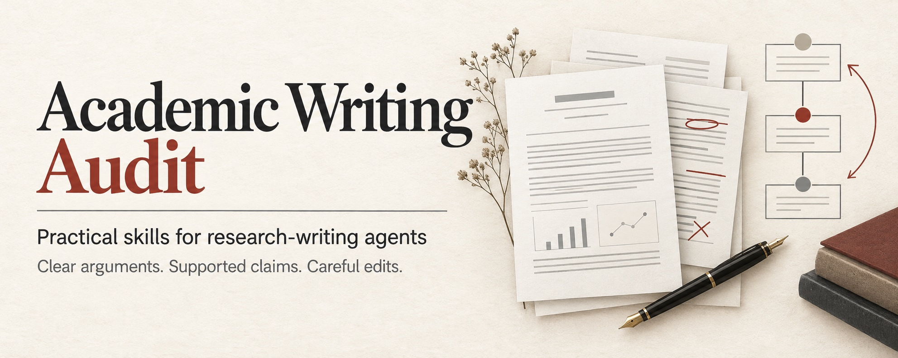

<p align="center">
  
</p>

# Academic Writing Audit：学术论证与写作审查

**18 个可独立使用的 agent skills，把论文写作、逻辑审查和审稿回复中反复遇到的问题整理成可执行的判断方法。**

[English](README.md) · [文献核验与引用](docs/reference-guide.md) · [专业角色与前后对照](docs/revision-guide.md) · [论文结构与写作](docs/manuscript-guide.md) · [自然表达与逻辑审查](docs/prose-guide.md) · [问题与修复示例](docs/field-guide.md) · [审稿回复指南](docs/rebuttal-guide.md) · [完整审查入口](skills/academic-writing-audit/SKILL.md) · [专项试用记录](evals/library/README.md) · [宣传素材](assets/README.md)

先理解研究主线，再检查证据与推理，最后决定哪里需要改。审查后判断“这段原样保留”，同样是有价值的结果。

英文核心指令便于不同 agent 使用；中文说明解释选择和调用方法。每个 skill 都是独立目录，不依赖某篇论文或特定模型。文献真实性核验明确要求两个独立 agent 从 Google Scholar 开始交叉检查；缺少相应能力时只能报告部分核验结果。

## 从哪里开始

| 你现在的任务 | 使用入口 | 期望输出 |
| --- | --- | --- |
| 第一次完整阅读一篇稿件 | [academic-writing-audit](skills/academic-writing-audit/SKILL.md) | 按重要性排列的问题、依据和保留项。 |
| 已知具体写作问题 | 从下表选一个专项 skill | 有范围、有依据的替换或补丁。 |
| 撰写 rebuttal 或逐点 response letter | [reviewer-response-writing](skills/reviewer-response-writing/SKILL.md) | 有依据的回应、准确的修改状态，以及单独撰写的正文修改。 |
| 比较压缩或修订前后的两个版本 | [revision-integrity-audit](skills/revision-integrity-audit/SKILL.md) | 原问题是否解决，有效逻辑和信息是否保留？ |
| 文献真实性、BibTeX 或 Word 引用核对 | [文献核验与引用指南](docs/reference-guide.md) | 区分真实存在、字段准确、版本一致和引用对应。 |
| 提交前检查版本和成品 | [manuscript-release-check](skills/manuscript-release-check/SKILL.md) | 已核实的源码、编译、渲染和发布状态。 |

```text
使用 $academic-writing-audit 独立阅读这篇论文。
先给结构化审查，不改文件。检查研究主线、证据边界、
比较对象、定义承接、冗余和防御性写作。
区分必须修正、值得改善和可以保留，注明位置与依据。
```

## 按问题选择 skill

| 遇到的问题 | Skill | 核心判断 |
| --- | --- | --- |
| 先理解研究，再起草或重组整篇论文 | [research-manuscript-writing](skills/research-manuscript-writing/SKILL.md) | 摘要、倒三角引言、关联文献与学科适配的结果是否围绕同一个问题？ |
| 文献是否真实，标题、作者、年份和刊物是否准确 | [reference-authenticity-audit](skills/reference-authenticity-audit/SKILL.md) | 两个 agent 是否独立从 Scholar 核查同一组文献，并逐字段交叉核验？ |
| 同一论文的 BibTeX 变成多条记录，或引用键冲突 | [latex-bibliography-audit](skills/latex-bibliography-audit/SKILL.md) | 是否以目标版本的 Cite → BibTeX 为准，并保持论文身份与引用键一致？ |
| Word 正文引用与文末参考文献对不上 | [word-citation-audit](skills/word-citation-audit/SKILL.md) | 是否先确定格式，再双向检查漏列、未引用、歧义和重复？ |
| 需要完整的科学与写作审查 | [academic-writing-audit](skills/academic-writing-audit/SKILL.md) | 论证、证据、读者功能、修改范围是否一致？ |
| 想去 AI 味，句式绕、衔接弱、同义重复多 | [academic-prose-editing](skills/academic-prose-editing/SKILL.md) | 具体表达、逻辑连接、句式负担和信息重复是否改善？ |
| 动机与方法之间缺一座桥；贡献缩成实现细节 | [scientific-story-audit](skills/scientific-story-audit/SKILL.md) | 问题、困难、贡献和证据是否真正连接？ |
| 正文像回复审稿人，反复保证“我们没有……” | [nondefensive-writing](skills/nondefensive-writing/SKILL.md) | 事实、措辞和位置分别是否有用？ |
| Related Work 变成论文清单或人为划分阵营 | [related-work-synthesis](skills/related-work-synthesis/SKILL.md) | 是否沿引言的问题链串联已有工作，而非分类罗列或反复对比本文？ |
| 用系统结果解释单个机制；用现有代码证明旧实验 | [claim-evidence-audit](skills/claim-evidence-audit/SKILL.md) | 哪份证据支持哪条主张，允许推断到哪里？ |
| 基线、消融、预算和数据范围说不清 | [experiment-comparison-audit](skills/experiment-comparison-audit/SKILL.md) | 实际改变了什么，而不是实验叫什么？ |
| Results 只报数字，或把解释写成因果证明 | [results-interpretation](skills/results-interpretation/SKILL.md) | 观察回答了什么，哪些机制仍未隔离？ |
| 公式和附录都有，但读者不知道方法做了什么 | [method-definition-audit](skills/method-definition-audit/SKILL.md) | 能否先用一句操作定义讲清，再核对顺序与参数？ |
| 图、箭头、图注和成功定义含义不一致 | [figure-caption-audit](skills/figure-caption-audit/SKILL.md) | 图的每个连接是否有真实语义支持？ |
| 审稿意见导致全文不断加解释、重复修补 | [reviewer-comment-triage](skills/reviewer-comment-triage/SKILL.md) | 当前稿还缺什么，最小修复应该放在哪里？ |
| 回复信绕开问题、证据不足，或把拟修改写成已完成 | [reviewer-response-writing](skills/reviewer-response-writing/SKILL.md) | 是否直接回答问题，证据是否对应，修改是否真实完成？ |
| 修改后更短，但可能丢失逻辑、条件或解释 | [revision-integrity-audit](skills/revision-integrity-audit/SKILL.md) | 区分合理压缩、有据纠错、信息丢失与未核实的迁移。 |
| 源码已改，PDF、线上预览和提交状态却不确定 | [manuscript-release-check](skills/manuscript-release-check/SKILL.md) | 每一个“完成”到底由什么观察证明？ |

不需要每次加载全部 18 个。先选择与当前问题最接近的入口；只有发现跨章节的问题时，再扩大审查范围。

## 理解研究之后再写章节

从想法开始写初稿时，先做[领域调研与故事线准备](docs/research-preparation.md)。按学科选择检索来源，阅读近期和基础研究的引言、综述、方法与证据，让多个 agent 先独立检查同一核心问题，再交叉核对。检索结果应能修正初始想法，不能只为预设 gap 找支持。调研中的分歧和备选路线留在准备记录里，正文写成有依据、简洁连贯的科学论证。

遇到明显的 gap，优先查是否已有尝试及其障碍，同时寻找其他术语下已有的成功解法。区分失败结果与失败原因，保留适用条件，检查重新尝试靠什么改变约束，以及这些改变是否已经验证。没有失败报告不能证明无人尝试，一次失败也不能证明普遍不可行。有价值的复现和边界检验不必包装成全新方向，原因仍未知时也不能编造研究历史。

[research-manuscript-writing](skills/research-manuscript-writing/SKILL.md) 先识别具体问题、动机、贡献和证据，再开始起草。引言动笔前先明确目标会议或期刊、读者及投稿重点，再沿一条倒金字塔逻辑，从相关进展收束到 gap、motivation 和 contribution。会议稿可以紧凑整合 gap 与 motivation，期刊稿则把问题、后果和思路依据讲清楚，具体要求以投稿方为准。后续审查删去不推进主线的解释和跳转，同时保留必要的推理桥梁。摘要沿问题到结果推进，文献综述从引言提取两到三个关联方向，把已有研究讲清楚，默认不分类罗列，也不反复对比本文。

方法按依赖顺序解释，避免重复定义和防御性强调。结果、局限性与结论根据研究设计和学科要求组织，整体使用简洁连贯的段落。支持 LaTeX 的引用和章节语法，以及 Word 的原生样式与字段保留。完整说明见[论文结构与写作指南](docs/manuscript-guide.md)。

## 专业角色与修改前后对照

完整审查根据子方向、研究设计、读者和具体判断选择 reviewer 与 editor 视角。先说明这部分应当建立什么、为什么，以及当前实际建立了什么，再判断缺口。真实审稿要求与 agent 推断的读者需要分开记录，不把某个学科的实验或统计标准套到所有研究。

[revision-integrity-audit](skills/revision-integrity-audit/SKILL.md) 比较修改前后，分别检查原问题是否解决、有效论证和信息是否保留。保留有依据的纠错、合理压缩和已核实的内容迁移，修复实际丢失的含义，不机械恢复旧稿。详见[专业角色与前后对照指南](docs/revision-guide.md)。

## 自然表达、简洁句式与逻辑审查

[academic-prose-editing](skills/academic-prose-editing/SKILL.md) 把“去 AI 味”落实到具体问题。删去没有信息的铺垫和夸赞，理清主语、动作与指代，检查相邻句子的推理是否成立，并合并承担同一解释任务的重复内容。不会靠生僻词替换、固定句长或作者身份判断来评价文字。

自然表达还要让读者看见论证如何展开。检查一段结束时多理解了什么、为什么需要下一步，以及证据如何支持或限制解释。句式与篇幅变化服务于信息重点，保留有用的平行结构和作者声音，不随机换词、不强制长短句交替，也不虚构作者的思考经历。详见[论证展开与表达节奏](skills/academic-prose-editing/references/reasoning-and-rhythm.md)。

正文和回复文本默认使用连贯段落，不用冒号引出解释，也不用破折号或两侧留空格的连字符在句中插入补充。术语内部的连字符，以及公式、负号、范围、比例、网址、原文引文和必要模板语法会保留。作者和期刊的明确要求优先。这套简版约定也已放入各专项 skill，单独安装时无需依赖另一个 skill。

概念与语言审查先核对词语所指的对象、使用范围，以及它隐含的性质或机制，再区分概念错误、正确概念的生硬表达、含义未明和已经准确的表述。概念错误按证据纠正，表达问题保留术语后修改搭配或句式，含义不明时标出待确认项，正确内容原样保留。改词前还要核对单位、条件、专业区分与结论强度，避免以流畅为由改变科学含义。正常专业术语、领域惯用表达和定义清楚的新概念都应保留。

实验简称要结合操作定义和上下文判断。简称容易误读，可以补充解释，不应直接判成科学错误。审查意见本身也接受相同检查，转述方法时不能添加来源未确认的机制或数学性质。

复杂句要在保留条件、例外和证据边界的前提下简化。摘要、独立图注和正文中承担不同任务的重述可以保留，已经连贯的动机段也不必改写。完整说明见[自然表达与逻辑审查指南](docs/prose-guide.md)。

```text
使用 $academic-prose-editing 检查并修改这段学术文字。
先检查推理、术语与词语搭配，再处理复杂句、模板化表达和重复信息。
使用连贯段落，不使用解释性冒号或句中破折号。
保留术语连字符、技术符号、原文引文、必要限制和已清楚的句子。
不要通过改写提高结论强度，简要解释实质修改。
```

## 审稿回复与正文分开写

新加入的 [reviewer-response-writing](skills/reviewer-response-writing/SKILL.md) 支持会议 **rebuttal / author response** 和期刊逐点 **response letter / 返修信**。方法来自实际回复写作及后续正文审查中反复遇到的问题；公开案例均为虚构，不包含原始审稿通信。

- **回复信**：直接回答问题，给出对应证据，说明实际修改、位置或尚未解决的限制。相同问题可合并回答，但每条具体请求都要有去向。
- **论文正文**：保留科学解释与证据边界，不写“为回应 Reviewer 2”“我们现已澄清”等回复口吻。把必要说明融入读者需要的位置，避免不断追加辩解。
- **修改状态**：拟议文字、作者报告已完成、实际核对完成分别标明；不编造实验、数值、引用或页码行号。

例如，核对 Methods 确已修改后，回复信可以写“我们已在 Methods 的 Comparators 小节补充基线的操作定义”。正文则直接写“该基线采用预设线性评分与固定组别系数，并拟合一个模型”。回复信说清修改，正文说清研究。

完整方法、反例和中文提示词见 [审稿回复与正文写作指南](docs/rebuttal-guide.md)。

## 怎样理解“去防御性写作”

一句话包含否定、限制或不确定性，并不意味着应该删除。我们分别判断：

1. **事实的作用**：删掉后，读者会误解什么或失去哪条逻辑连接？
2. **表达的方式**：它是在说明操作和观察，还是在预先反驳、保证正确？
3. **出现的位置**：读者此时是否需要它，附近是否已完成相同的解释任务？

例如，虚构草稿写道：

> 我们强调，不完整的测量绝没有被悄悄丢弃。读者不应认为本系统保证现场运行可靠。

若已知事实是不完整测量触发弃权、保留在分母中、不输出浓度估计，且未开展现场评估，则可改成：

> 不完整测量触发弃权，不输出浓度估计，并保留在评估分母中。本研究没有评估现场运行。

语气更直接，但算法规则、分母和证据边界完整保留。前文若已清楚解释研究动机，就不再改写。

## 文献真实性与引用核对

新增三个独立入口。真实性核验要求两个 agent 各自从 Google Scholar 检查同一组文献，核对完整标题、完整作者及顺序、发表年份和刊物，并各自检查原始出版信息，再比较证据。查不到、访问受阻和字段不一致分别记录，不把“未核实”写成“假文献”。

LaTeX 以目标论文及版本的 Scholar Cite → BibTeX 原始导出为基准，检查同一论文的重复记录和引用键冲突，保留需要分别引用的预印本与正式版本，导出遗漏的已核实 DOI 等有效字段也保留并注明来源。三个入口复用带来源记录的文献清单，引用键或格式变化不触发重复核验。Word 先明确所需引用规范，再检查正文中的每处引用是否对应文末条目，以及文末是否有未在已检查范围内引用的条目，同时保护 Zotero、EndNote 等引用域。

具体流程、访问受阻时的处理，以及可直接复制的请求见[文献核验与引用指南](docs/reference-guide.md)。这些检查分别回答真实性、格式和对应关系，不能替代“这篇文献是否支持正文论断”的内容审查。

## 安装

可以先[下载便携发布包](https://github.com/ChangChrisLiu/academic-writing-audit/releases/latest)，也可以按下面的方法单独安装。

目录遵循 [Agent Skills 格式](https://agentskills.io/specification)。支持原生 skills 的客户端可以发现入口；其他 agent 也可以直接阅读 Markdown。可移植不意味着已验证所有模型表现相同。

可选用 [Skills CLI](https://github.com/vercel-labs/skills)：

```sh
# 列出可安装的 skill，不执行安装。
npx skills add ChangChrisLiu/academic-writing-audit --list

# 安装一个，按提示选择目标客户端。
npx skills add ChangChrisLiu/academic-writing-audit --skill nondefensive-writing

# 在当前项目中为 Codex 安装全部 18 个。
npx skills add ChangChrisLiu/academic-writing-audit --skill '*' -a codex
```

需要用户级安装时加 `-g`。已有同名 skill 时，先比较版本和目标位置。

也可以手动把 `skills/` 中选定的整个文件夹复制到客户端的 skills 目录，保留其中的参考文件和 `LICENSE`。[英文说明](README.md#manual-installation)包含 Codex 示例。`agents/openai.yaml` 只是可选的展示信息。当前会话没有发现新 skill 时，在新会话中使用。

对于不能安装 skill 的 agent，提供 `SKILL.md` 及需要的参考文件，然后直接要求按文件中的方法完成任务。

## 可以直接复制的请求

**Rebuttal / response letter 与正文修改**

```text
使用 $reviewer-response-writing，根据这些真实审稿意见、当前稿件和
实验记录起草回复。遵守我提供的篇幅与投稿规则，先回答实质问题，
再给证据、解释边界和修改位置；不要把计划写成已完成。
单独列出建议的正文替换，正文不得出现回应 reviewer 的口吻。
保留尚未解决的问题，不编造实验、阈值、引用或页码行号。
```

**有明确范围的修改**

```text
使用 $experiment-comparison-audit 修改这份稿件的实验设置段。
按真实操作核对基线、数据范围、训练与选择预算、消融含义。
直接完成有依据的局部修复，保留数值和已成立的作者表述。
如果材料冲突，指出冲突；不要编造一个统一解释。
```

**保留解释力度的结果段**

```text
使用 $results-interpretation 检查这一节。
区分观察、解释和因果归因，保留对研究问题有用的分析。
不要把所有解释都删成报数，也不要把同一批运行中的阶段结果
当作独立消融。给出需要改的句子和应该保留的句子。
```

**图注与图意核对**

```text
使用 $figure-caption-audit 对照这张图、图注和方法段。
检查箭头、数据流、对照组范围和实际评估终点。
说明哪些判断来自可见图像，哪些只能由提供的描述支持。
```

更完整的虚构案例与任务模板见 [field guide](docs/field-guide.md)。

## 验证记录

[最初的完整审查试用](evals/README.md)包含 5 次无 skill 对照、5 次带 skill 试用及 4 个迁移场景；在这个小样本中，带 skill 的回答更稳定地保留了一段已经连贯的研究动机。

[10 个专项 skill 的试用记录](evals/library/README.md)公开场景、语义标准和完整回答。这组对照本身已解决核心问题，因此不能据此声称专项 skill 提高了准确率。测试用于检查具体行为、保留失败和支持后续回归检查，不代表跨模型或跨学科有效性认证。

回复写作 skill 已完成[七个领域、十次独立上下文的带 skill 试用](evals/reviewer-response-writing/transfer/README.md)，另由评估 agent 核对。保存的正文均未出现回应审稿人的口吻，并保留了作为研究对象的“reviewers”。两份初始回答中“未提供分析”被写成“分析不可用”的范围歧义，促成了针对性澄清和新上下文回归试用。完整回答、初始评估和明确标注的追问复核均公开。这些同一运行环境下的虚构案例没有无 skill 对照，不能证明所有模型或学科都适用。

自然表达与逻辑审查更新完成了[三次独立上下文的带 skill 试用](evals/academic-prose-editing/README.md)，覆盖英文修订、中文只审查以及回复信与正文同步修改。另一位评估 agent 判定 16 项适用标准均满足，技术符号和引文得到保留，回复口吻没有进入正文。这组测试没有无 skill 对照，只说明已观察案例中的表现。

专业用词更新另有[三次带 skill 试用](evals/academic-language/README.md)，包含 dataset 与 buffer 的针对性区分。保存的输出纠正了术语误用和动作主体问题，保留了有效专业词与未解决的含义问题。这些虚构案例只支持对已观察行为的判断。

通用概念审查完成了[数学、化学、经济学和质性研究四个领域的独立上下文试用](evals/concept-language-transfer/README.md)。另一位评估 agent 判定 24 项检查均通过，未发现正常专业术语、定义清楚的新概念或准确段落被误改。这组同一运行环境下的虚构案例实际测试了两个 skill 入口，不代表普遍可靠性认证。

另有一次[真实长文审查](evals/real-manuscript-audit/README.md)，使用已知项目的完整正文与历史回复检查术语和正文语气边界。初次独立评估发现两处局部分类或转述问题，促成了有针对性的规则修补。两次新上下文复测的 12 项判断均通过，并保留一处轻微表述判断意见。公开记录说明方法和有限结论，原稿与审稿材料保留在本地。

[整篇写作与章节结构试写](evals/manuscript-structure/README.md)覆盖工程、质性研究、数学文献，以及只有题目但缺少研究事实的请求。独立评估的初测 16 项、复测 10 项适用判断均通过，并保留两处可选编辑意见。格式检查覆盖 LaTeX 源码和可粘贴的 Word 文字，不代表实际编译或原生 Word 版面通过。

[专业角色与修改前后对照试用](evals/roles-revision-integrity/README.md)覆盖机器人检测、数值分析和组织民族志。独立评估的 21 项检查均通过，另保留两处可选措辞意见。输出分别检查原问题是否解决和信息是否保留，接受合理压缩及有据纠错，未发现正常专业术语误改。这组虚构带 skill 试用没有无 skill 对照，不代表普遍有效性证明。

[论证展开与自然表达试用](evals/reasoning-rhythm/README.md)覆盖工程方法、中文生态结果解释和数学段落的保留判断。独立评估的初测 15 项、复测 5 项通过。记录保留可选的措辞与精简意见，初测的一处表达在复测中仍出现，不能据此宣称规则已消除所有直译感。这些带 skill 试用没有无 skill 对照，也不评价作者身份。

[文献真实性与引用核对试用](evals/reference-integrity/README.md)包含两位 agent 对同一组公开文献的独立实时检索，以及一次虚构 LaTeX 和 Word 格式案例审查。两位 agent 都保留了 Scholar 访问未完成的状态。格式试用检查重复论文、不同版本、引用键冲突和文档覆盖范围，不代表 Scholar 导出、LaTeX 编译或原生 Word 文档已经验证。

[文献工作流执行测试](evals/reference-workflow/README.md)新增两位 agent 各自完成的 Scholar 检索与原始出版信息核对、实际 Cite → BibTeX 导出，以及编译并查看页面后的 LaTeX 去重修复。Scholar 未导出的已核实 DOI 得到保留。该记录保留了首次 Word 操作受阻的状态，后续的[原生 Word 刷新测试](evals/word-native-refresh/README.md)已在选择 APA 第六版后完成刷新、保存和重新打开核对。正文与表格的两处引用分别对应文末两条文献，三个原生域及两个来源身份均保留。这个构造案例不代表其他引用管理器集成或普遍可靠性已经验证。

[Word 引用扩展测试](evals/word-citation-transfer/README.md)由两位 agent 独立使用 skill 审查同一组同作者同年、真实脚注、图注、未引用文献和不完整导出案例，并设置不加载引用 skill 的对照。另一位 agent 复核了完整报告与实际文件。三组判断均符合案例要求，修正正文笔误后七个域全部保留。对照组也通过，因此本次不证明 skill 带来了性能提升；没有发现需要新增规则的问题，skill 内容保持不变。

[引言收束与投稿适配检查](evals/introduction-focus/README.md)覆盖会议和期刊试写、缺少投稿对象、档案研究的逻辑跳转，以及压缩后丢失的推理桥梁。三次独立上下文执行包含一次针对性复测，初次期刊稿重复已有解释的问题促成了规则补充。评估由 skill 作者完成，记录保留首次不足及复测中可进一步精简的表述，没有无 skill 对照或独立评分者。

[调研到故事线测试](evals/literature-to-story/README.md)使用机器人和社会史虚构材料，实际执行独立调查、交叉复核和写作交接。互查发现了将“引用某研究”扩大成“建立在该研究之上”的归因问题；首次汇总还把选题决策写进了正文，补充规则后用新上下文复测。完整记录保留这些不足和修正过程。评估由 skill 作者完成，没有无 skill 对照，也不代表实时文献检索已经验证。

[研究 gap 反向核查测试](evals/gap-persistence/README.md)使用五个领域的虚构研究案例及一个局部语法对照。两位 agent 先独立调查再互查，另由独立 agent 按预先制定的标准评估。检查失败的适用条件、替代术语下的解法、重新尝试的依据、未知历史与复现价值，同时查看准备记录会不会混进正文。这些是固定材料的开发测试，没有实时检索或无 skill 对照。

## 素材与贡献

宣传图采用纸张、墨色和批注的学术编辑风格，由 OpenAI 内置 GPT 图像生成工具制作。三张原图、网页版本及实际生成提示词都在 [media kit](assets/README.md) 中。它们用于展示工作方式，不作为实验结果图。

项目采用 [MIT 许可证](LICENSE)，每个独立 skill 都附带许可证。欢迎按 [贡献指南](CONTRIBUTING.md)提供可复现的问题、最小修改和测试案例。公开内容使用通用方法与虚构或已授权材料，不包含私人稿件和内部评审通信。
