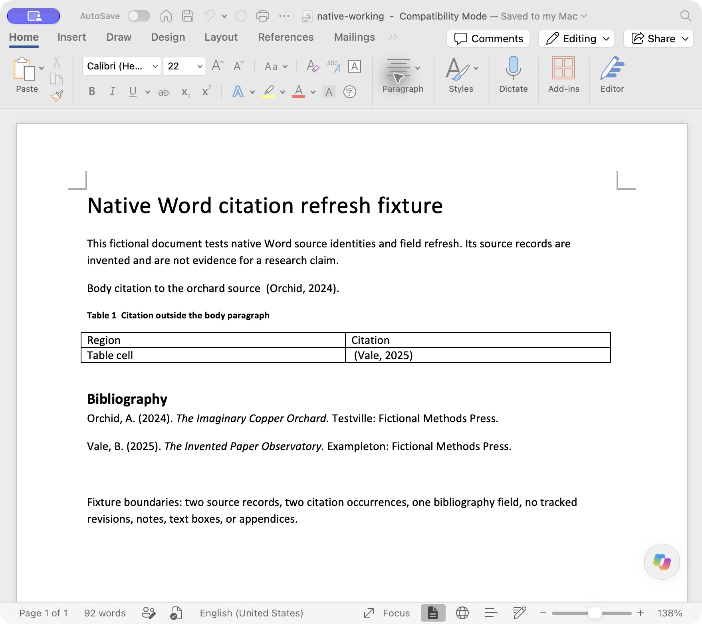

# Native Word refresh follow-up

On 22 October 2026, Microsoft Word refreshed and saved the fictional native citation fixture from the [earlier blocked attempt](../reference-workflow/operations/word/REPORT.md). Reopening the saved document preserved both citation mappings, both embedded source identities, and all three live fields. The original fixture and earlier failure record remain unchanged.

This is a single operational continuation, performed and assessed by the same agent. It is not a blinded skill comparison, an independent-agent assessment, a real manuscript audit, or a test of literature authenticity. Both books are explicitly fictional. No research manuscript was edited.

## Observed result

| Location | Field target | Before | Saved and reopened result | Reference entry |
| --- | --- | --- | --- | --- |
| Body paragraph | `Orchid2024` | Pending refresh marker | `(Orchid, 2024)` | Orchid, A. (2024). *The Imaginary Copper Orchard*. Testville: Fictional Methods Press. |
| Table cell | `Vale2025` | Pending refresh marker | `(Vale, 2025)` | Vale, B. (2025). *The Invented Paper Observatory*. Exampleton: Fictional Methods Press. |
| Bibliography | `BIBLIOGRAPHY` | Pending refresh marker | Two entries, each appearing once | Both sources cited within the fixture |

The two `CITATION` instructions and one `BIBLIOGRAPHY` instruction remain unchanged, including their locale switches. All three complex fields retain their separators and end markers. Source tags, GUIDs, and bibliographic metadata remain intact. The [comparison record](native-comparison.json) contains eleven passing structural and mapping assertions. These assertions are paired with native execution and page evidence, rather than treated as proof that XML inspection itself performed a refresh.

The actual Word menu was used to select **APA Sixth Edition**. Word then stored `/APASixthEditionOfficeOnline.xsl`. The input's `/APA.XSL`, `StyleName="APA"`, and `Version="6"` had not established an active selection in the ribbon. This test does not evaluate whether every output detail conforms to an external style manual.



## Execution and recovery

The tested baseline was repository commit `aa1f52125f6de669ac07cec5745362567a808cc1` (v0.7.1). Word was version 16.114.1, build 16.114.26102031, on macOS. The document opened in Compatibility Mode. The user authorized Word's native AppleScript interface and restarted Word after earlier AppleEvent timeouts.

The first post-restart open attempt encountered Word's file-access dialog and timed out. Opening the exact test copy through Word's normal file UI succeeded. Native field updates then ran, but the combined script failed at `save as` with error -1708. The updated document was saved through Word's Save command instead. This failure does not establish that Word generally lacks Save As support.

After selecting APA Sixth Edition, a separate update-only script returned `true` for each field and confirmed unchanged instructions. Its [before/after log](native-api/refresh.stdout.txt) records an **idempotent repeat refresh**, so its before values are already formatted. The transition from pending markers is evidenced by the original DOCX, [native before screenshot](native-before.png), and saved after DOCX. No citation cache was edited manually.

The exact working document was saved, then copied byte for byte to `native-refreshed.docx`. Word subsequently closed that saved working document and reopened it. The close/reopen script's reporting step failed with -10006 because the variable name `rows` collided with Word terminology. A separate read-only check using `auditLines` confirmed the reopened file's exact path, saved state, three instructions, and results. The [reopen log](native-api/reopened.stdout.txt), native screenshot, and unchanged on-disk hash establish persistence. The historical script and error are retained; the failure is not counted as a successful script exit.

During the initial update, accessibility text briefly retained the table's pending marker while the actual Word screenshot, native field API, and saved DOCX showed `(Vale, 2025)`. A fresh read after reopening agreed with the document. No field was rewritten to match the stale accessibility extract.

## Recheck the evidence

The [before document](before.docx) is unchanged from the prior fixture. The [after document](native-refreshed.docx) is the exact Word-saved package, obtained by filesystem copy rather than native Save As. Source and field inventories are available [before](before.inventory.json) and [after](native-refreshed.inventory.json).

With Python and `lxml`, run these commands from this directory to repeat the static checks. They read DOCX packages and regenerate the JSON reports; they do not invoke Word or prove a new native refresh.

```sh
python inspect_fixture.py before.docx
python inspect_fixture.py native-refreshed.docx
python compare_native.py
```

The scripts under `native-api/` are historical execution records with `.txt` suffixes, including failed attempts. Local paths were replaced with `/TEST_WORKDIR`; they are not a general-purpose automation tool. The [publication transformations](publication-transforms.json) disclose the original and public script/log hashes. DOCX files and native screenshots were not altered for publication. The [artifact manifest](manifest.json) hashes the public evidence and revised Word skill.

The [secondary PDF](render-after/native-refreshed.pdf) and [page image](render-after/page-1.png) were generated from the saved DOCX using the bundled document renderer and LibreOffice. The single page was visually inspected for readable citations, two entries, and unclipped content. These are secondary layout checks; native Word evidence comes from the actual API, screenshot, and reopened document.

## Resulting skill clarification and limits

The skill now distinguishes native refresh, save, and reopened verification. It also calls for checking the actual selected style and resolving stale accessibility text against the native page, field result, and saved document before proposing a repair. The test found no lost fields or incorrect source mappings. These clarifications address verification gaps, not a demonstrated citation corruption defect.

This fixture covers two Book sources, one body citation, one table citation, and one bibliography field. It does not test footnotes, text boxes, tracked revisions, ambiguous author-year labels, numeric styles, large manuscripts, Word on Windows, or Zotero, EndNote, and Mendeley integrations. It supplies no evidence that the fictional sources exist or support a research claim.
